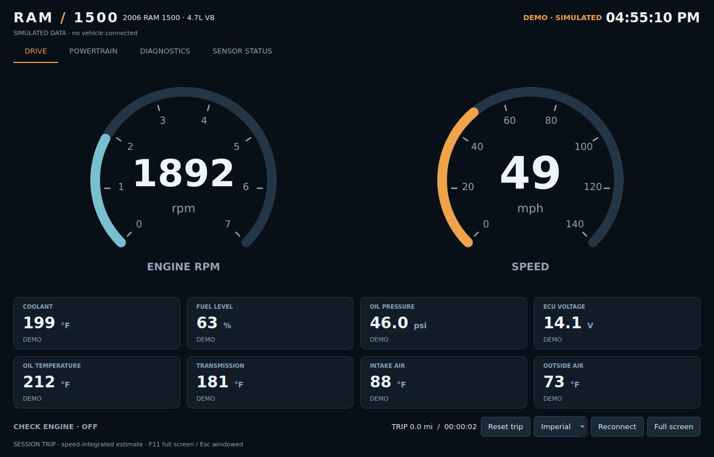

# Ram 1500 Digital Dashboard

A Python and PyQt5 dashboard for a 2006 Ram 1500. The default vehicle label is the 4.7L V8; change it with `--vehicle` if needed. One serial worker owns the OBD adapter so gauges do not compete for connections or block the interface.



*Preview uses simulated data. It is not a recording from a truck.*

## Run the demo

Use Python 3.10 or newer. Create and activate a virtual environment, then:

```sh
python -m pip install -r requirements.txt
python OBDII.py --demo
```

The demo does not open a vehicle connection. The header and every reading identify simulated data.

## Connect to the truck

Use an ELM327-compatible USB or paired serial Bluetooth adapter supported by python-OBD. Connect it to the truck's diagnostic port and turn on the ignition. For example:

```sh
python OBDII.py --port COM7
```

On Linux:

```sh
python OBDII.py --port /dev/ttyUSB0 --fullscreen
```

Omit `--port` for python-OBD port detection, or set `OBD_PORT` in the shell. `.env.example` is a reference; the app does not load `.env` automatically. If needed, specify `--baudrate 38400`. Protocol detection is automatic unless `--protocol` is supplied. Do not assume a protocol from the model year alone.

USB is the intended first test path. Wi-Fi adapters and raw Bluetooth BLE devices are not implemented as separate transports.

## Instruments

| Display | Source | Behavior |
| --- | --- | --- |
| Speed, RPM | Standard OBD-II | Large dials, prioritized serial polling |
| Coolant, fuel level | Standard OBD-II when supported | Temperature and fuel percentage |
| ECU voltage | Standard OBD-II when supported | ECU-reported supply voltage |
| Adapter voltage | ELM327 adapter | Separate powertrain reading; not mislabeled as ECU voltage |
| Oil temperature | Standard PID when supported, or external sensor | No temperature is inferred if unsupported |
| Oil pressure, transmission temperature | External calibrated sensor feed | Unconfigured until a real feed is supplied |
| Intake/outside temperature | Standard OBD-II when supported; outside can use external data | Missing readings remain unavailable |
| Load, throttle, manifold pressure, fuel trims, run time | Standard OBD-II when supported | Powertrain and sensor-status tabs |
| Clock | Computer's local time | Updates without an adapter |
| Trip distance/time | Current session | Distance estimated by integrating fresh vehicle-speed samples |
| Check-engine state, stored engine codes | OBD status and Mode 03 | Read-only diagnostics with explicit unknown/stale state |

Imperial/metric controls convert speed, temperature and pressure. Runtime is shown as hours:minutes:seconds. Adapter voltage is a reading at the diagnostic connector, not a replacement battery tester.

Generic OBD-II does not provide a complete factory instrument-cluster feed. Oil pressure and transmission temperature require a verified Chrysler-specific decoder or external sensors. This implementation supports external sensors; it does not ship guessed Chrysler PIDs. Gear, turn signals, ABS/airbag warnings, fuel range, factory odometer and engine-oil level are not fabricated.

## Controls and recording

- F11 or **Full screen** toggles fullscreen; Escape returns to a window.
- **Reconnect** closes and reopens the adapter; failed connections retry automatically.
- **Read engine trouble codes** requests stored engine DTCs. There is no clear-code or actuator-control operation.
- **Reset trip** clears the in-memory session trip, not the truck's odometer.
- `--units metric` starts in metric mode.
- `--record trip.csv` writes canonical-unit readings, source and data states once per second. An existing file is never overwritten. Demo recordings are labeled `demo`.

Polling rates are best effort: speed/RPM are requested frequently, slower readings every few seconds and diagnostics every 30 seconds. Adapter latency and supported PIDs determine the actual update rate. Sensor Status shows age, source and support state. Failed/expired data is shown as a dash, never as a reassuring zero. Stale samples do not add trip distance.

## Oil pressure and transmission inputs

See [external sensors](docs/EXTERNAL_SENSORS.md). A serial-to-JSON bridge is included for a separate calibrated sensor controller. Configuration is not a substitute for installing and calibrating a sensor. The truck's actual available PIDs and hardware still need to be tested.

## Tests

```sh
python -m unittest discover -s tests -v
```

On a headless Linux machine, set `QT_QPA_PLATFORM=offscreen`. Tests cover unit conversions, invalid/stale data, trip gaps, external sensor validation, CSV recording, transport behavior, diagnostics and Qt worker/UI lifecycle. GitHub Actions runs these tests and a demo render without connecting to a vehicle.

## Layout

- `OBDII.py`: command-line entry point.
- `dashboard/telemetry.py`: readings, conversion, trip, external data and recording.
- `dashboard/transport.py`: live OBD and explicit demo transports.
- `dashboard/worker.py`: serial polling, reconnect and diagnostic scheduling.
- `dashboard/ui.py`: instrument and diagnostic screens.
- `tools/sensor_bridge.py`: calibrated serial-sensor input bridge.
- `config/sensors.example.json`: null placeholders documenting the external input format.

The old independent gauge scripts are replaced by this single application; there is one Qt application and one OBD connection.

## Vehicle validation

Software tests and a rendered demo are not road or hardware validation. Verify each supported reading against a reliable reference while parked. Keep the factory instruments and warning lights available; this app is an auxiliary display, not a validated replacement instrument cluster. It does not implement oil-pressure, overheating or other factory protection alarms.

Source references: [python-OBD commands](https://python-obd.readthedocs.io/en/latest/Command%20Tables/), [connection behavior](https://python-obd.readthedocs.io/en/latest/Connections/).
